

  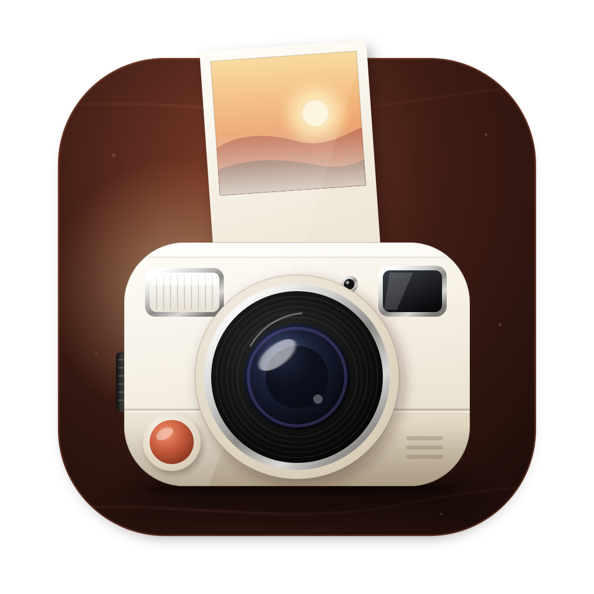

<h1 align="center">Nocchi · 刘海冲印店</h1>

  <strong>The notch is a darkroom.</strong> 
  把 MacBook 的刘海，变成一台复古相机的出片口。

  
  
  
  
  
  

  <a href="https://chaosnap.github.io/Nocchi/"> Docs</a> ·
  <a href="https://chaosnap.github.io/Nocchi/zh/"> 中文文档</a> ·
  <a href="#features"> Features</a> ·
  <a href="#screenshots"> Screenshots</a> ·
  <a href="#download"> Download</a> ·
  <a href="CHANGELOG.md"> Changelog</a> ·
  <a href="PRIVACY.md"> Privacy</a>

  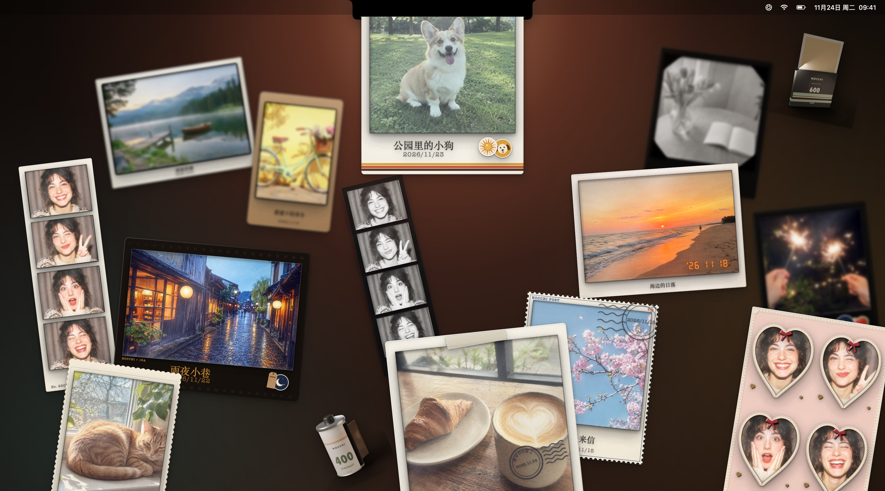

##  刘海冲印店 · The notch darkroom

**刘海冲印店** means "the notch photo lab". Nocchi turns the notch at the top of your MacBook's screen into the print slot of a retro instant camera. Take a screenshot or a selfie and the print slides out of the notch, a little at a time, to the sound of a motor; then it develops slowly on your desktop, the way real instant film does. Shake it to hurry it along (shake too hard and you will get chemical blotches), write on its white border, decorate it, stick it to the edge of the screen, and file it away in a wooden card box.

The iPhone version will use the Dynamic Island as its print slot, with a Live Activity that shows the print developing.

Everything happens on your Mac: no account, no cloud, no telemetry. The film looks are computed from parametric recipes at run time, and every camera body, film canister, sticker and paper template is original artwork.

##  Features

###  Shoot

- **Screen shutter** (⌃⌥⌘S): drag out any part of the screen and it comes out of the notch as a print. Optionally, ⇧⌘3 / ⇧⌘4 screenshots become prints too.
- **Selfie** (⌃⌥⌘F): a lens-shaped viewfinder grows out of the notch, with a three-second countdown and a white-screen fill flash.
- **Photo booth** (⌃⌥⌘B): a velvet curtain closes, you pick a frame in a brass-trimmed showcase (eleven frames, a four-frame strip or a 2×2 grid, black and white or color), drop a coin, and after four flashes the strip comes out of the notch.
- **Print anything**: drop an image on the notch, or print from Files (⌘O) or Photos (⇧⌘O).
- **Any camera**: the built-in camera, external and virtual cameras (OBS, Camo and other camera extensions) and Continuity Camera.

### 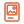 Develop

- Prints develop over about fifteen seconds. Drag one around and shake it to speed things up.
- **26 original film stocks**: instant films, color negatives, night and cinema stocks, black and white, and two photo-booth stocks, each with its own rendered canister or film pack. Import your own `.cube` LUTs, or export any stock as one.
- **6 paper formats**: square, mini and wide instant, a 3:2 lab print, a four-frame booth strip and a 2×2 booth grid.
- The film cabinet lives in the notch: hover, tap the canister, load another roll.

###  Decorate

- Write on the white border with your trackpad; the line follows the pressure.
- **The decorating desk**: pens, markers, oil crayons and paint pens in eight enamel colors; **60+ retro stickers** (vinyl badges, rubber stamps, tickets and stamps, washi tape, embossed labels you can type on); **16 paper templates** (deckle edge, date stamp, film frame, postage stamp, 70s stripes, photo-studio card, and booth themes such as hearts, gold stars, birthday and new year); captions in handwriting, typewriter or letterpress type, with a place and #tags.
- Share posters at 1080 × 1350 on linen, walnut, kraft paper, velvet or cork.

###  Keep

- New prints gather in a pile at the top right. Drag them anywhere; near the edge of the screen they snap on like fridge magnets; pin them behind your windows on the desktop layer.
- **The notch shelf**: drag prints into the notch to stash them, then drag them out again as image files.
- **The album**, four ways to look: a corkboard with brass pins and washi tape, a beechwood card box with A–Z dividers (cards rise out of the box and fan out), a film light table with a loupe, and a retro wall calendar. Search by caption, #tag, place, film, date, or the pinyin initials of a Chinese caption.

##  Screenshots

Every picture here is rendered from the app itself by [GitHub Actions](.github/workflows/screenshots.yml): Nocchi's screenshot mode develops a set of original sample photos with its real film stocks and templates, then captures its own windows and panels. More in the [gallery](https://chaosnap.github.io/Nocchi/guide/gallery) · [截图（中文）](https://chaosnap.github.io/Nocchi/zh/guide/gallery).

###  The notch

<table>
  <tr>
    <td width="50%">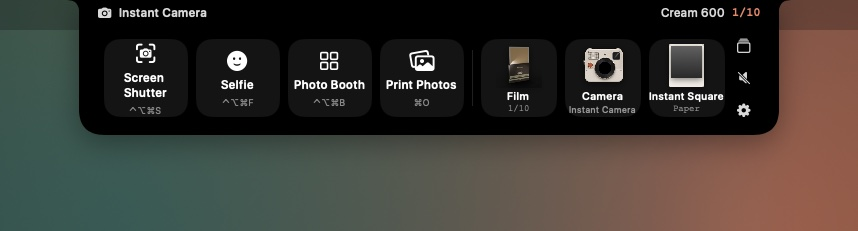 Hover over the notch: the camera panel</td>
    <td width="50%">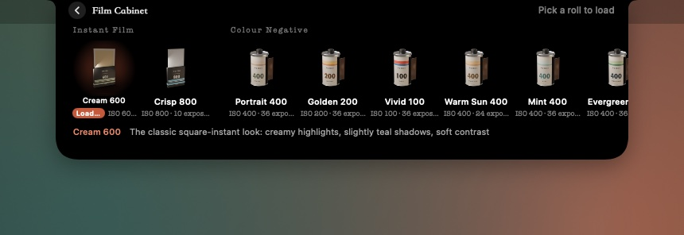 The film cabinet in the notch</td>
  </tr>
</table>

###  Prints and the photo booth

<table>
  <tr>
    <td width="50%">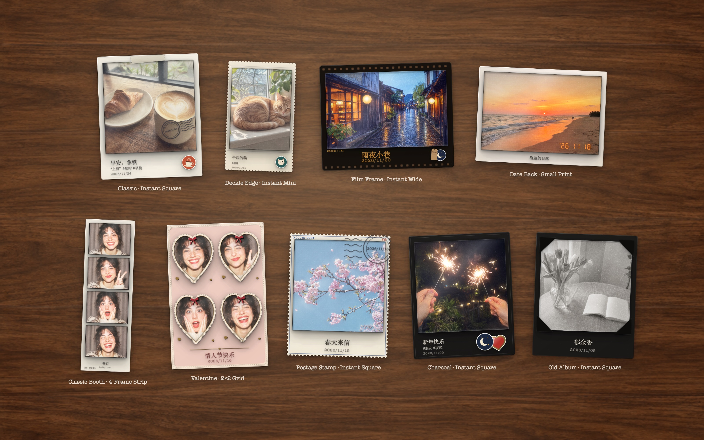 Six papers, sixteen templates</td>
    <td width="50%">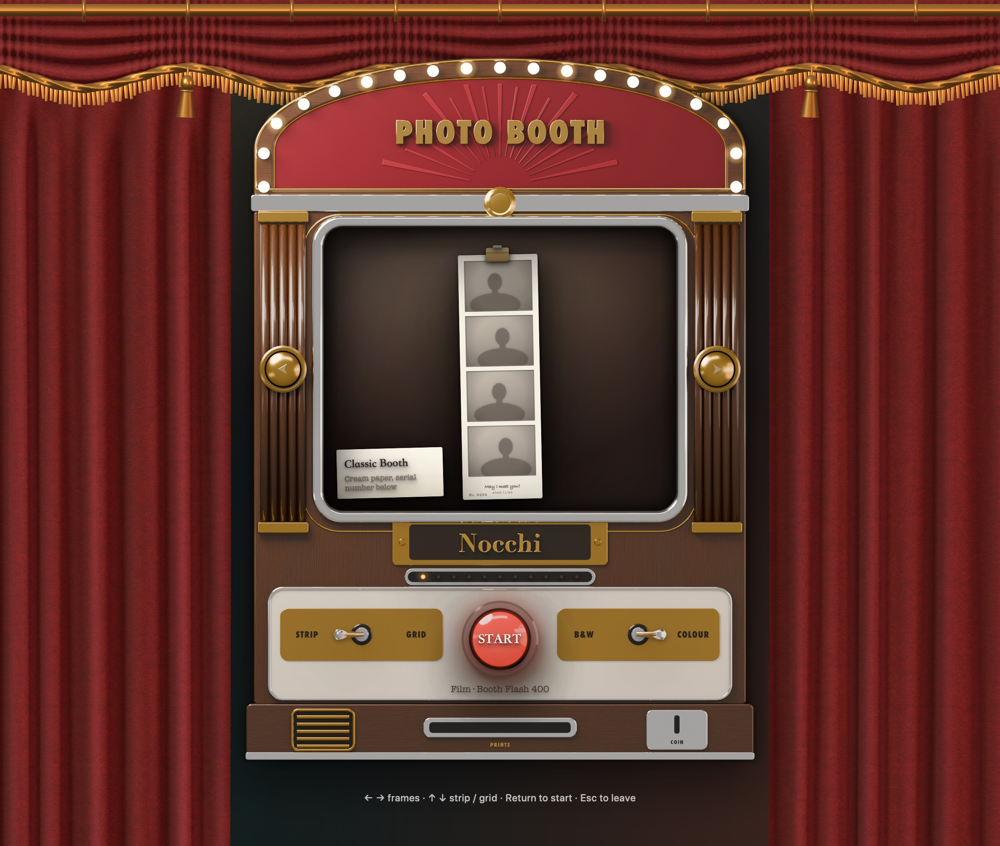 The photo booth: choose a frame, then drop a coin</td>
  </tr>
  <tr>
    <td colspan="2">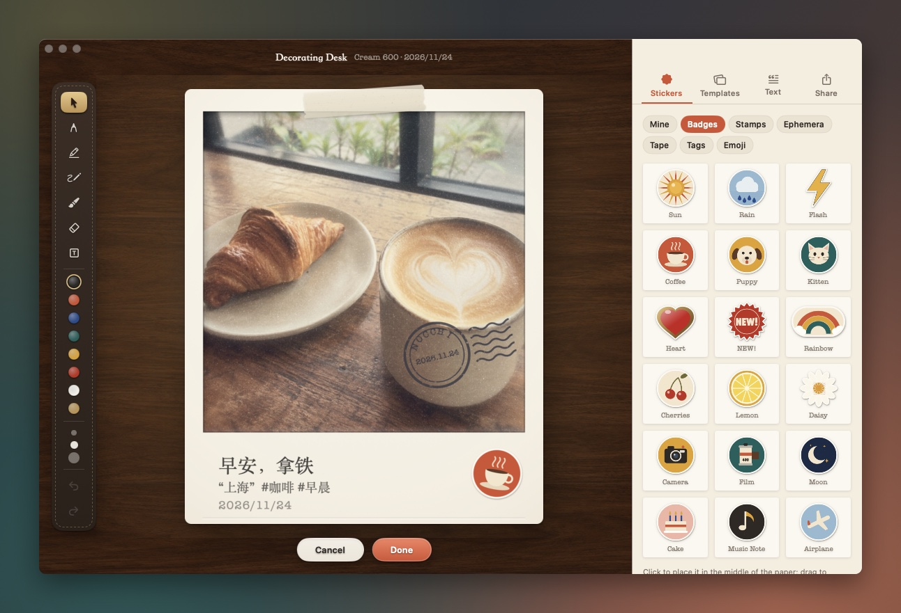 The decorating desk: pens, stickers, templates, captions and posters</td>
  </tr>
</table>

###  The album

<table>
  <tr>
    <td width="50%">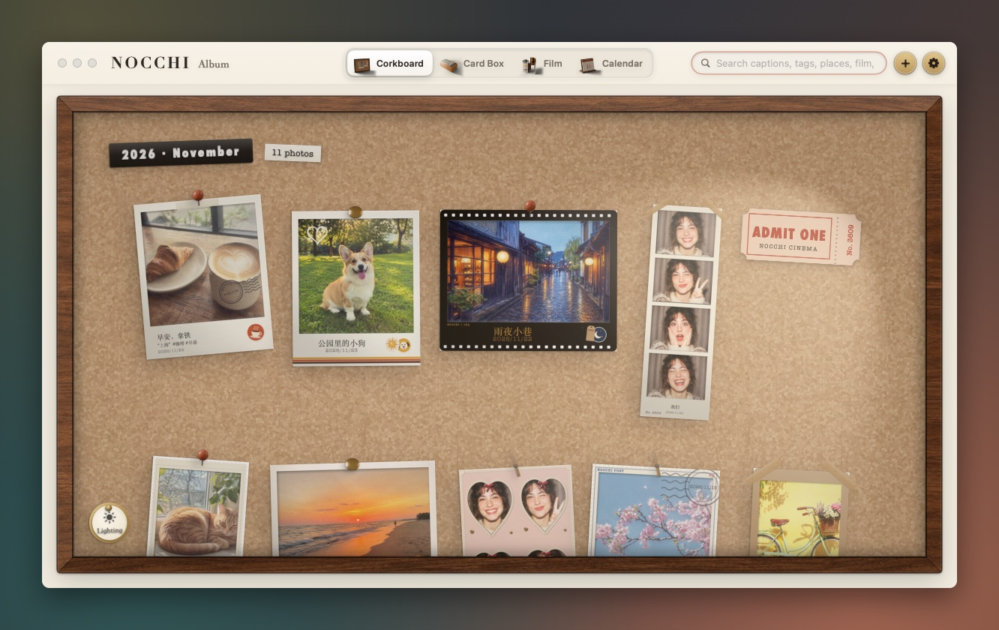 Corkboard</td>
    <td width="50%">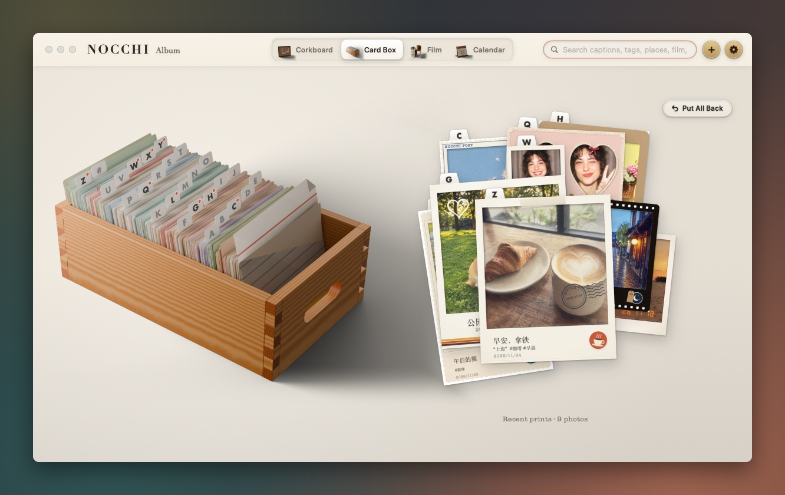 Card box</td>
  </tr>
  <tr>
    <td width="50%">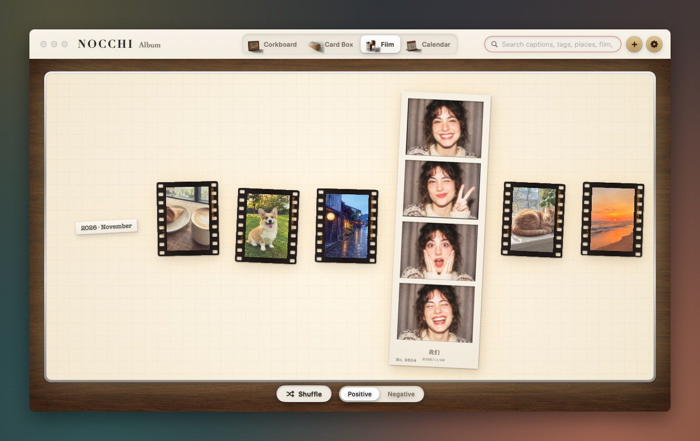 Film light table</td>
    <td width="50%">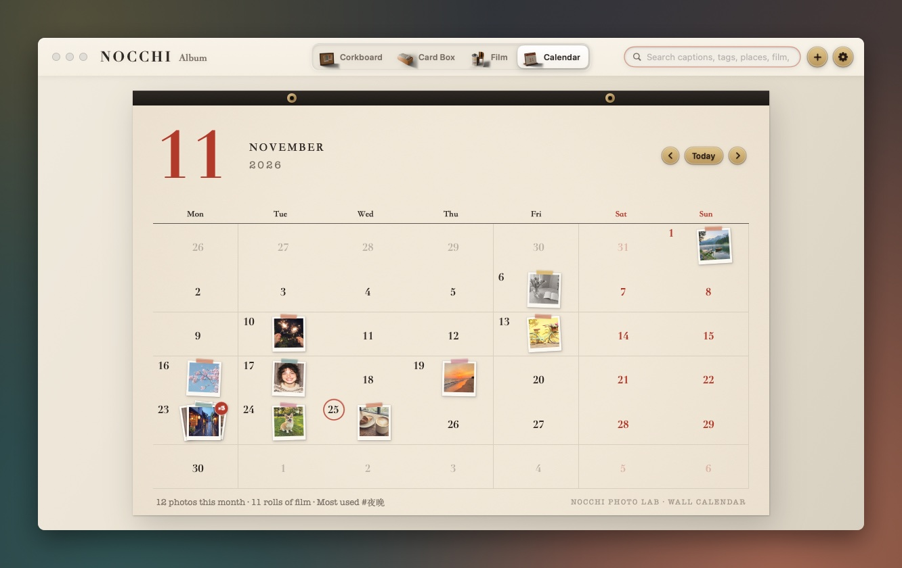 Wall calendar</td>
  </tr>
</table>

##  How to play (macOS)

| To | Do this |
| --- | --- |
| Open the camera panel | Move the pointer onto the notch |
| Screen shutter | ⌃⌥⌘S |
| Selfie | ⌃⌥⌘F (Space takes the picture, Esc cancels) |
| Photo booth | ⌃⌥⌘B (← → frames, ↑ ↓ strip / grid, Return starts, Esc leaves) |
| Develop faster | Drag a print and shake it |
| Decorate a print | Double-click it, or right-click → **Decorate…** |
| Write on the border | Right-click → **Write on the border** |
| Stash a print | Drag it onto the notch |
| Open the album | ⌘0, then ⌘1–⌘4 for the four views, ⌘F to search |

The interface is in Simplified Chinese or English. It starts in Chinese; switch in *Settings (⌘,) → 通用 (General) → 语言 (Language)* and relaunch.

##  Download

Get the latest build from [Releases](https://github.com/Chaosnap/Nocchi/releases/latest):

| Platform | File | Notes |
| --- | --- | --- |
|  macOS 14 or later | `Nocchi-macOS-<version>.zip` | Universal (Apple silicon and Intel). Ad-hoc signed and not notarized yet: move it to Applications and run `xattr -dr com.apple.quarantine /Applications/Nocchi.app`, or click "Open Anyway" in System Settings → Privacy & Security |
|  iPhone | — | In progress |

Every release comes with `SHA256SUMS.txt`. Builds of the latest commit are attached to each green run of [CI](https://github.com/Chaosnap/Nocchi/actions/workflows/ci.yml) as artifacts.

##  Documentation

**[chaosnap.github.io/Nocchi](https://chaosnap.github.io/Nocchi/)** has the full guide in English, and **[中文文档](https://chaosnap.github.io/Nocchi/zh/)** in Chinese: installing, taking pictures, the photo booth, film and paper, the decorating desk, the album, shortcuts, settings, privacy and FAQ. The site is built from [`website/`](website/) with VitePress.

##  Where it stands

**Nocchi 2.0** polishes the photo lab: the photo booth is one Blender-modelled art-deco machine (bulb marquee, chrome window, a gilt Nocchi maker's plate) in front of a theatre-red velvet curtain, the Valentine frame is rebuilt with die-cut paper lace and gold foil, you can add text boxes, your own fonts and your own stickers, the corkboard is softer with an adjustable lamp and swinging prints, cards slide out of the card box like real ones, and prints come out of the notch with real physics. Next comes the iPhone app. The live progress board is [docs/PROGRESS.md](docs/PROGRESS.md) (in Chinese).

##  How it's built

- **Everything is compiled, tested, packaged and released on GitHub Actions**; nothing is built on anyone's own computer. CI generates the Xcode projects with XcodeGen, runs the `NocchiKit` unit tests, builds the app, and publishes a release whenever a `v*` tag is pushed. The screenshots and the documentation site are made there too. See [docs/CI.md](docs/CI.md) and [Built in the cloud](https://chaosnap.github.io/Nocchi/guide/building).
- `Packages/NocchiKit` is the shared darkroom core: film recipes and 3D LUTs, the Core Image pipeline, development and shake detection, paper composition, templates, stickers, the photo library and procedural sound. `macOS/` is the Mac app, `iOS/` the iPhone app and its Live Activity.
- The 3D props (card box, film canisters, pins, loupe) are rendered with Blender from the scripts in [`design/blender/`](design/blender/); the icon's source is [`design/icon/nocchi-icon.svg`](design/icon/nocchi-icon.svg); the sample photos used for the screenshots are in [`design/screenshots/samples/`](design/screenshots/samples/) (original, generated for this project).
- The development documents are written in Chinese: [concept](docs/notch-camera-concept.md), [design spec](docs/DESIGN.md), [architecture](docs/ARCHITECTURE.md), [decisions](docs/DECISIONS.md), [film stocks](docs/FILM_STOCKS.md), [assets](docs/ASSETS.md) and [CI](docs/CI.md).

##  Contributing

Read the [contribution guide](CONTRIBUTING.md) and the [Code of Conduct](CODE_OF_CONDUCT.md). Bugs and ideas go to [Issues](https://github.com/Chaosnap/Nocchi/issues/new/choose); security problems are reported privately, as described in [SECURITY.md](SECURITY.md).

##  License and credits

Nocchi is © 2026 Chaosnap and is free software under the **[GNU AGPL-3.0](LICENSE)**. The [Code of Conduct](CODE_OF_CONDUCT.md) is adapted from the [Contributor Covenant 3.0](https://www.contributor-covenant.org/version/3/0/) (CC BY-SA 4.0). The film stocks, camera bodies, templates and stickers have original names and designs and are not affiliated with any camera or film maker.
